# 検証結果（Fable 5.2 磨き直し）　2026-11-10

- 対象：ブランチ `fable52-improve`（修正前＝main の c2ec6d5。公開中のページと同じビルド）
- 方法：ヘッドレス Chrome（`--enable-unsafe-webgpu`）で開発サーバーの実際の画面を開き、操作して撮影。スクリプトは [scripts/fable52/verify.mjs](../../scripts/fable52/verify.mjs)。結果の生データは `before_jpg/before_report.json` と `after_jpg/after_report.json`
- 実行した機械：Mac（Apple GPU）のヘッドレス Chrome。**実機のスマートフォン・Safari・Windows では確かめていない**（スマホ幅は、画面の大きさとタッチ・モバイルのユーザーエージェントをまねたもの）

## 1. まとめ

| 項目 | 修正前 | 修正後 |
|---|---|---|
| コンソールエラー（PC幅 1440×900） | 0件 ※ | **0件** |
| コンソールエラー（スマホ幅 390×844） | 0件 ※ | **0件** |
| コンソールエラー（タブレット 768×1024・横長 1024×768） | 未計測 | **0件** |
| WebGPU なし | 「表示できません」の行き止まり（リンク1本） | **地点選択・公式想定・逃げる場所・避難メモが使える**。エラー0件 |
| WebGL2 もなし（地図も出せない） | ページ全体が止まる（地図ライブラリの例外） | **文字だけで公式想定と逃げる場所が出る**。エラー0件 |
| フレームレート（PC幅・格子768²） | 60fps | 60fps |
| フレームレート（スマホ幅・格子512²） | 60fps | 60fps |
| 再現の読み込み（「再現する」から3D表示まで・2回目以降はキャッシュあり） | PC 3.4秒／スマホ幅 1.8秒 | PC 1.2秒／スマホ幅 0.5秒（キャッシュの効いた状態。悪化なし） |
| 画面の重なり（常設の札・上の帯・右の欄・ドック・通知） | スマホ幅で右の欄とドックが画面の約85%を覆い、3Dがほぼ見えない | **全幅で重なり0件**（実測。スマホ幅でも3Dが見える） |
| ソルバーの単体テスト（/test.html） | 3本合格 | **3本合格**（静止湖：流速3e-5・質量誤差−5.5e-10／ダム崩壊：中央水深0.883（理論0.889）／海浜の水位上げ：汀線3.24m（入力3m））。物理（src/sim）と描画（src/render）は変更なし |
| `npm run build` | 通る | **通る**（JS 2,179kB・gzip 611kB。修正前は gzip 約588kB＝会議でのカシワギの実測。増分は約23kB） |

※ 国土地理院の標高タイルは、海のタイルに 404 を返す仕様。ブラウザが出すその行は「想定内」として数えていない（修正前・修正後とも同じ扱い。URL が標高タイルであることをスクリプトで確かめている）。

## 2. 通した操作（修正後・11通り、すべてエラー0件）

| 名前 | 画面 | 内容 | 結果 |
|---|---|---|---|
| pc1440 | 1440×900 | ガーデンふ頭 → 公式想定 → 3Dで再現 → **最後まで**（再現の時計 40:20）→ 結果 → Esc → 避難メモ → 選び直し | ここの最大 1.8m、周りの100m四方 2.3m、公式 1.3m（周り300m以内 2.5m）。「備えは少なくとも 2.5m」 |
| sp390 | 390×844 | 同じ流れ（途中まで） | 途中の結果は「まだ途中です」＋公式想定。Esc で閉じてボタンへ戻る |
| noreach_pc1440・noreach_sp390 | PC・スマホ幅 | **共有リンクの形**（`?lat=…&lon=…&h=2`）で、海の高さ2m・防潮壁4.6m → 最後まで | 「計算した約40分の間、ここに水は届きませんでした。**安全という意味ではありません**」＋条件の注意＋公式 1.3m／2.5m＋備え。設定画面にも注意 |
| tab768・land1024 | 768×1024・1024×768 | 再現中の重なりの実測 | 重なり0件。右の欄は畳んだ状態で始まる |
| inland_pc1440 | 1440×900 | 名古屋駅（内陸・二段ネスト計算） | 広域＋詳細で動く。公式は「この100m四方は浸水セルなし。安全という意味ではありません」 |
| kochi_sp390 | 390×844 | 高知市 種崎（名古屋以外） | 逃げる場所（種崎地区津波避難センター ほか）が出る。「ケース01は、この地域で津波が最も高くなるケースではありません（11m／15m）」。周り300mの最大は地点選択と3Dで同じ 6.6m |
| nogpu_pc1440・nogpu_sp390 | PC・スマホ幅 | WebGPU なし（WebGL はあり） | 地点選択・公式想定・逃げる場所が出る。3Dの設定は出ず、理由の文が出る |
| nogl_sp390 | 390×844 | WebGL2 もなし | 地図の代わりに説明文。名前で選べば、公式想定と逃げる場所が文字で出る |

レビュー役（別のサブエージェント）が自分のスクリプトで確かめたもの（`レビュー生記録/`）：キーボードだけの操作、Tab の順、ダイアログのフォーカス、通信を切った状態での「取得できませんでした」と再試行、逆ジオコーダの遅延・失敗、3回続けての選び直し（GPUエラー0）、読み込み中のキャンセル、`?demo=1`、自動開始のリンク、リサイズ、表示の切りかえと視点、コントラスト比、文字サイズ、タップ領域。

## 3. 修正前と修正後の画面

### 地点を選んだ直後（スマホ幅）

| 修正前 | 修正後 |
|---|---|
| 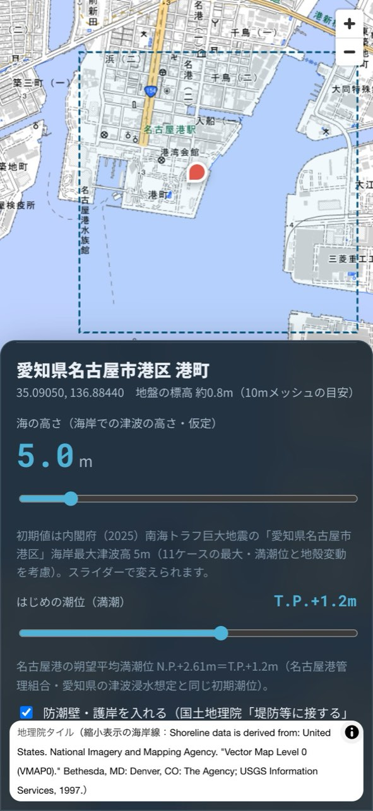 | 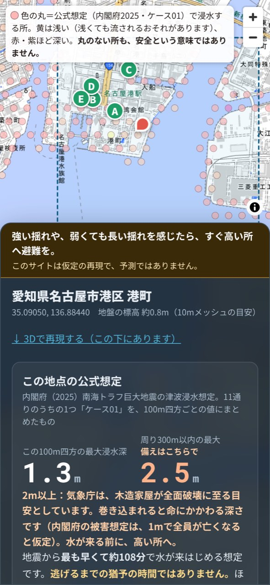 |
| 題名と注意が画面の外へ。専門の設定が並ぶ。地図の出典がカードを覆う | 「強い揺れ…すぐ高い所へ」が常に上に。公式想定（この100m四方 1.3m／周り300m以内 2.5m）と逃げる場所が先 |

### 再現中（スマホ幅）

| 修正前 | 修正後 |
|---|---|
| 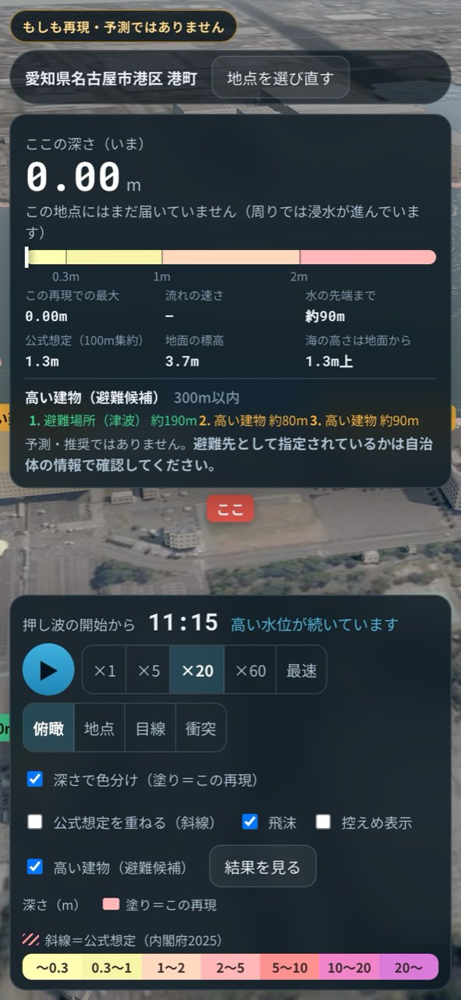 | 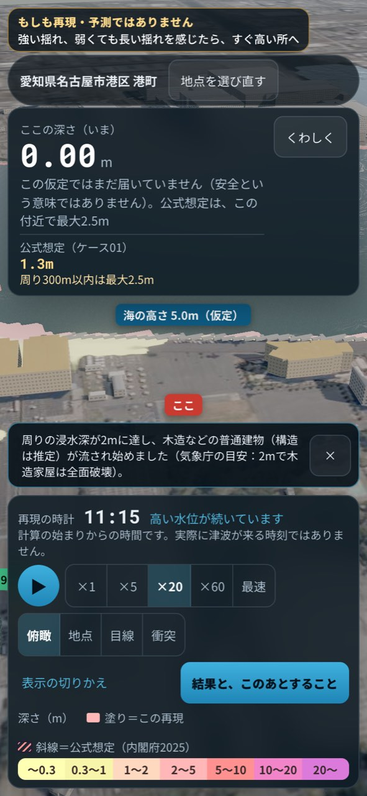 |
| 右の欄とドックで画面がほぼ埋まる。「まだ届いていません」の隣に公式想定が小さい | 3Dが見える。届いていない間も「安全という意味ではありません」と公式想定 |

### 結果（PC幅）

| 修正前 | 修正後 |
|---|---|
| 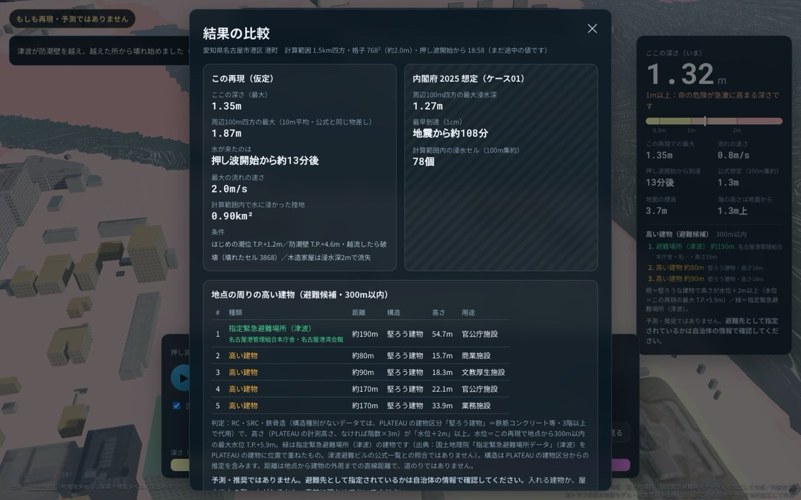 | 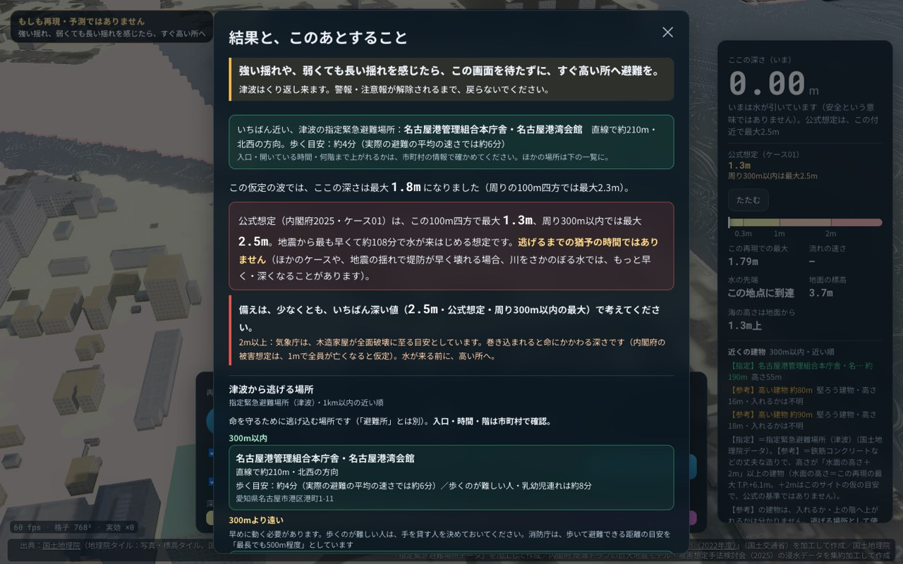 |
| 数字の比較が先。「強い揺れを感じたら…」は一番下。「押し波開始から約13分後」 | 呼びかけ → いちばん近い逃げる場所 → 要点（再現・公式・備え）→ 一覧 → 数字の比較。再現の到達時刻は出さない |

### 水が届かなかった結果（スマホ幅・修正後のみ）

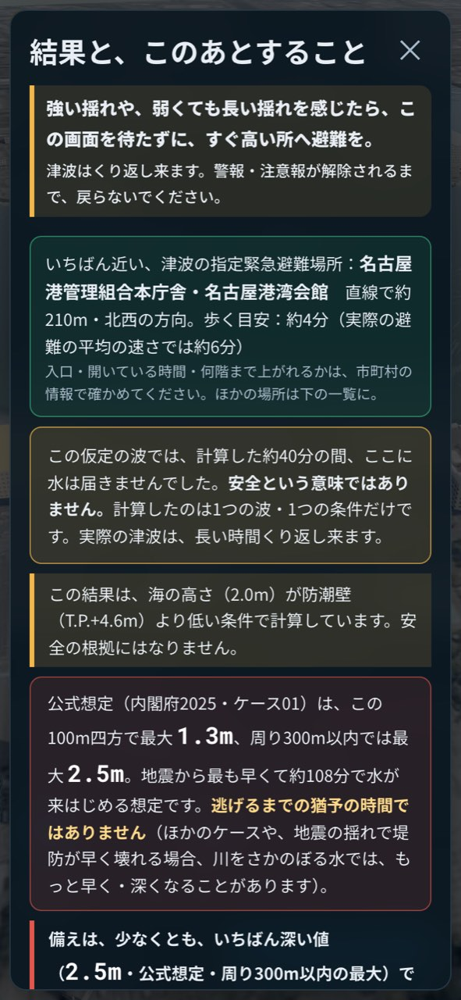

### WebGPU がない端末（スマホ幅）

| 修正前 | 修正後 |
|---|---|
| 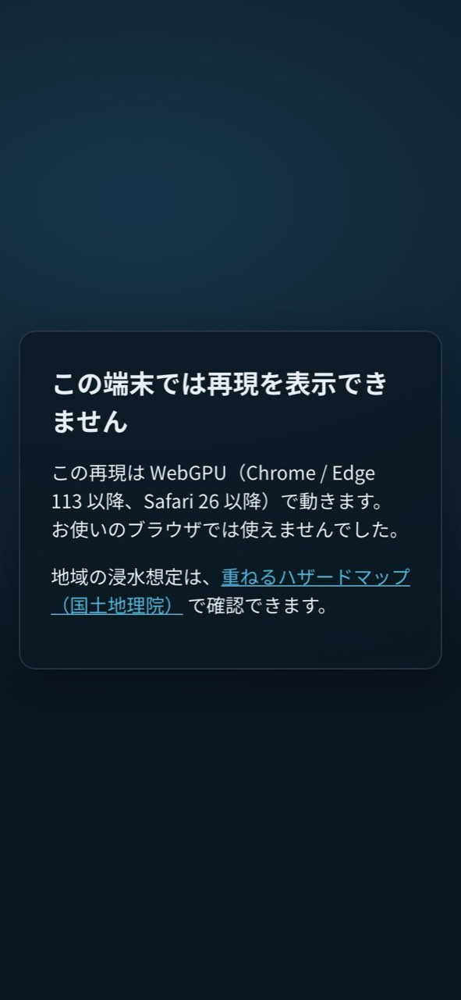 | 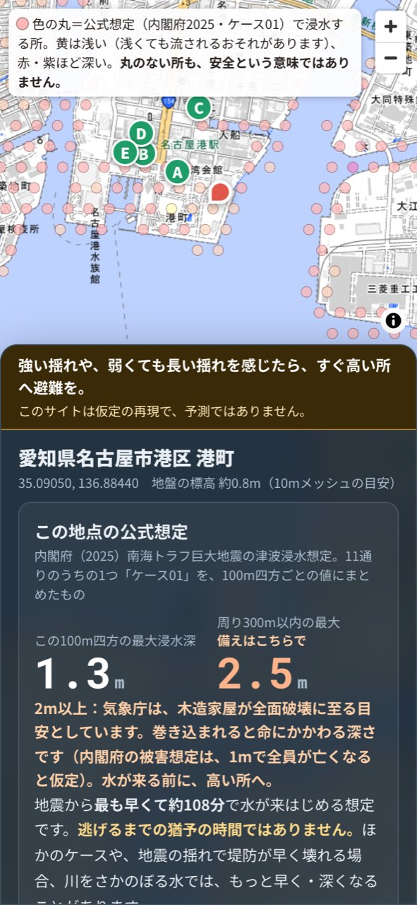 |

### 名古屋以外（高知市 種崎・修正後）

| 地点選択 | 結果 |
|---|---|
| 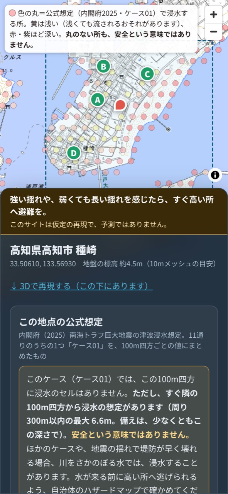 | 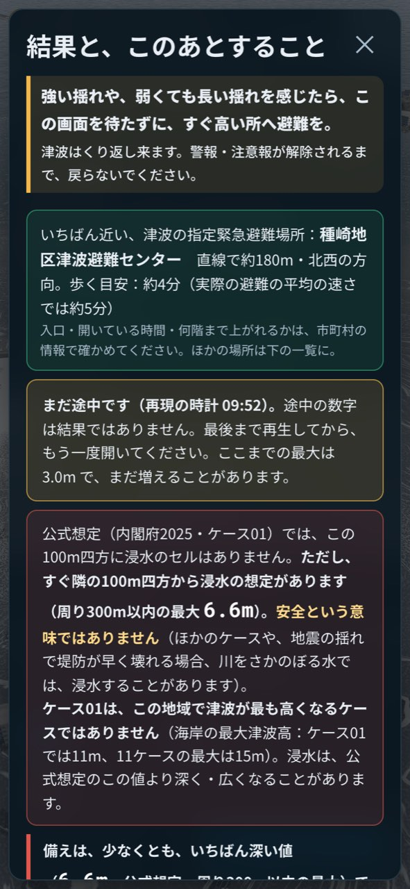 |

### タブレット幅・横長（修正後）

| 768×1024 | 1024×768 |
|---|---|
| 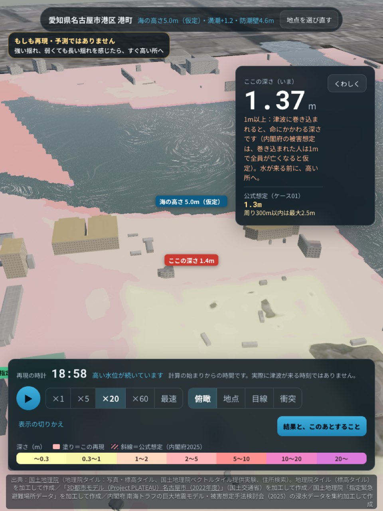 | 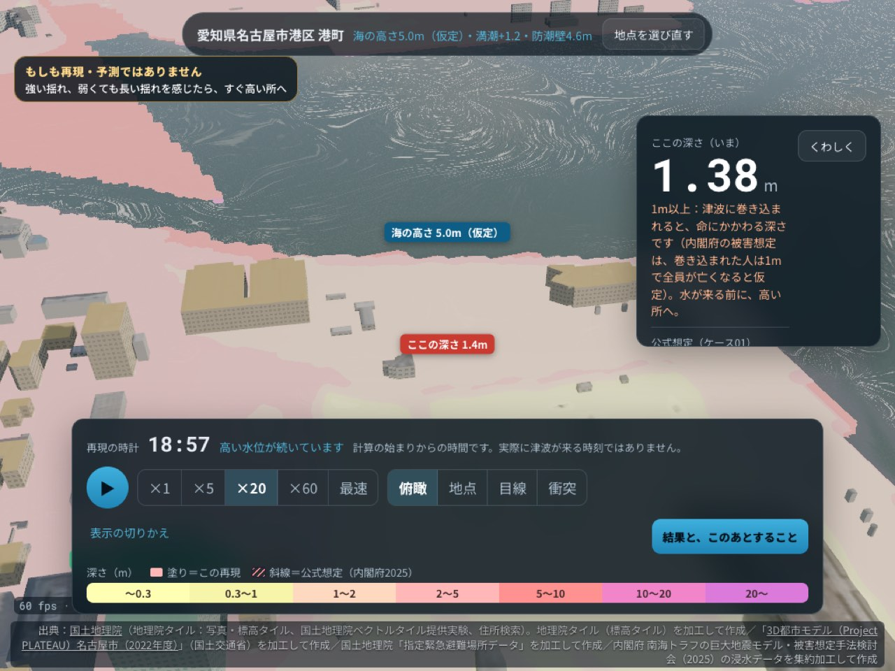 |

ほかの画面（地点選択のPC幅、3Dの設定、結果の下、避難メモ、内陸、WebGL2なし）は `after_jpg/` にある。

## 4. 数字の照合（実データとの手計算。レビュー役による）

| 地点 | 画面の値 | 実データ（public/inundation・public/data） |
|---|---|---|
| ガーデンふ頭 35.0905, 136.8844 | この100m四方 1.3m・地震から最も早くて約108分・周り300m以内 2.5m | 最寄りセル 33m先・1.27m・6504秒（108.4分）。周り300m以内の最大 2.53m |
| 同上：海岸の津波高 | ケース01で5m、11ケースの最大5m | 内閣府一覧：港区 5・5・4・4・4・5・5・5・5・4・4 |
| 高知市 種崎 33.5061, 133.5693 | この100m四方は浸水セルなし・すぐ隣から・周り300m以内 6.6m・ケース01は最大でない（11m／15m） | 自セルなし（最寄りの中心83m・縁17m）。周り300m以内の最大 6.63m。高知市：ケース01＝11m、最大15m（ケース④） |
| ガーデンふ頭の逃げる場所 | 名古屋港管理組合本庁舎・名古屋港湾会館 約210m・北西 | 国土地理院データで 215m・北西 |
| 種崎の逃げる場所 | 種崎地区津波避難センター 約180m・北西 | 182m・北西 |

## 5. 確かめていないこと・残っていること

- **実機のスマートフォン、Safari、Windows**：動作・発熱・速度とも未確認（ヘッドレス Mac の値だけ）。
- **スクリーンリーダーの実機での読み上げ**：属性（aria-live、見出し、ランドマーク、フォーカス）は確かめたが、VoiceOver などでの実際の読み上げは未確認。
- **印刷の実物**：印刷用の内容（HTML）は確かめたが、紙・PDF の出力は未確認。
- **選び直すたびに JS ヒープが約120MB残る**：修正前から同じ（修正前 431MB／修正後 452MB、3回選び直し後）。原因は未特定。物理・描画に手を入れない方針のため、今回は直していない。
- **国土地理院の逆ジオコーダ**が遅い日がある（この日は初回20秒）。その間は「選んだ地点（○○の近く）」と仮の条件で出し、届いたら差し替える。
- **公式想定はケース01だけ**：ほかのケース・都道府県や市町村の想定は収録していない（画面でそう書き、ケース01が最大でない地域には注意を出す）。11ケースの最大の浸水データを収録することは、今後の課題。
- **公開していない**：S3 への公開、GitHub への push、main へのマージは行っていない。`dist/` は `npm run build` で修正後のビルドに置き換わっている（git 管理外）。**公開するときは、この `dist/` が修正後の内容であることに注意**。
