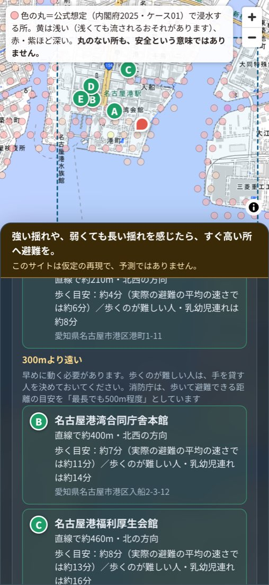
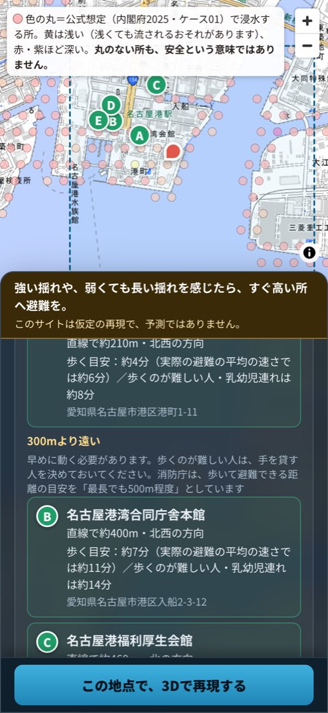
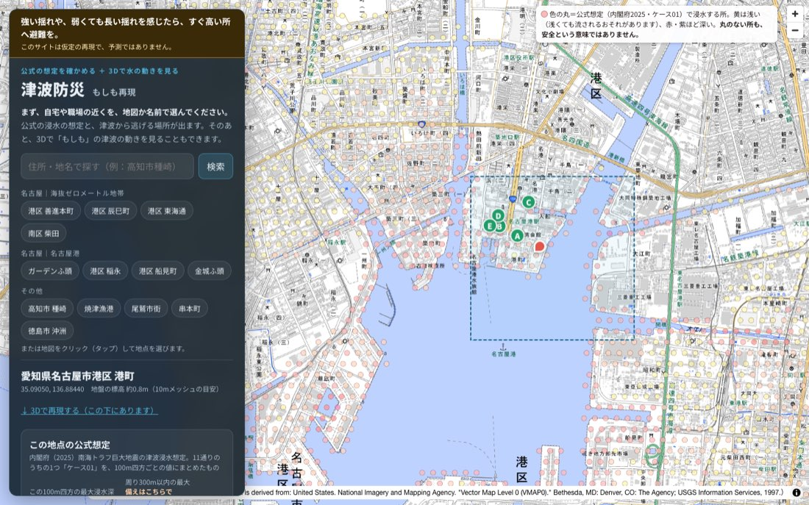
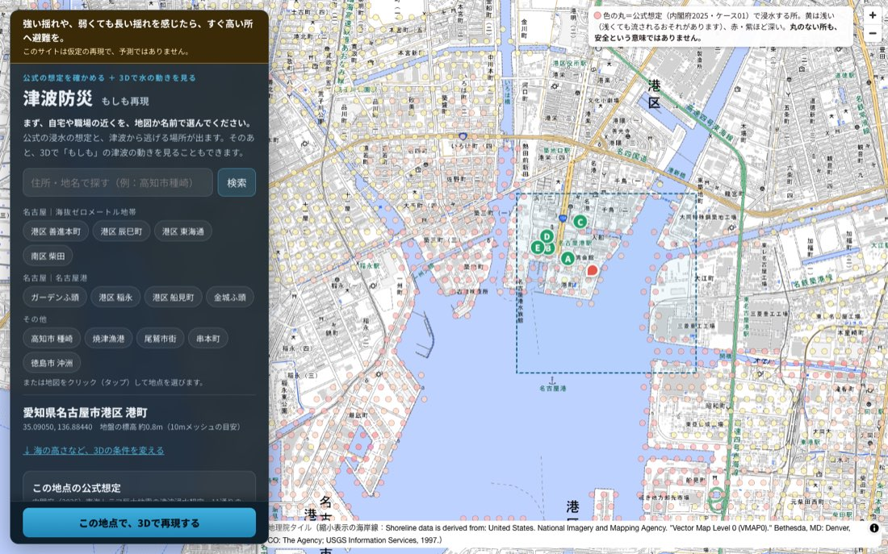
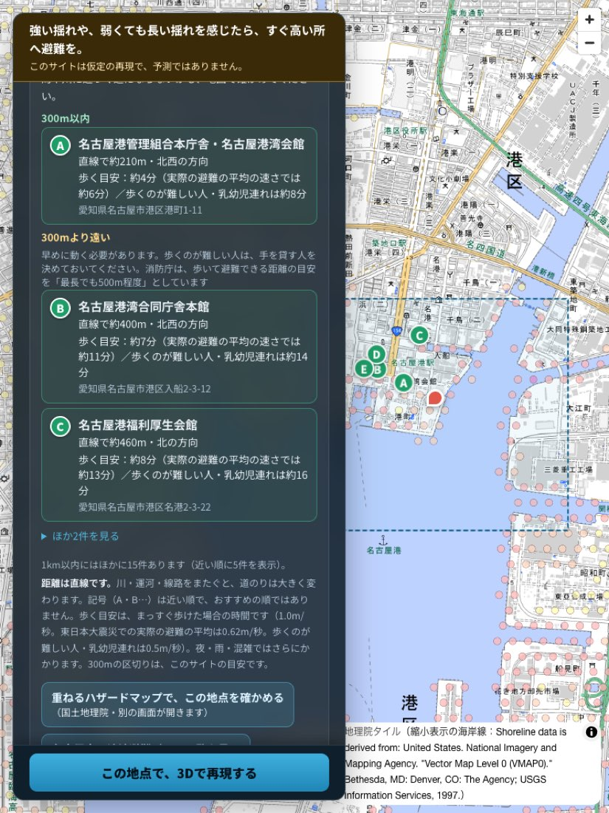
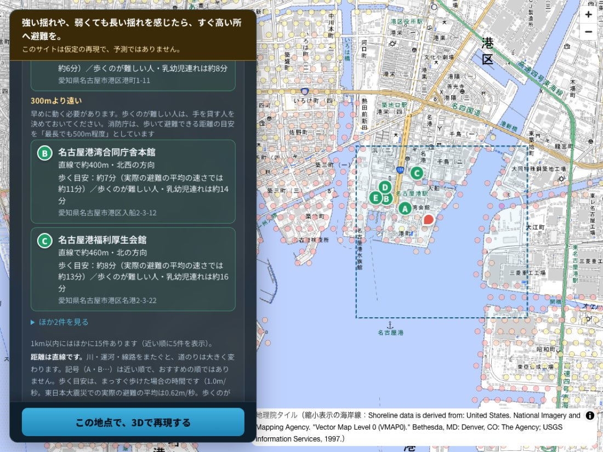
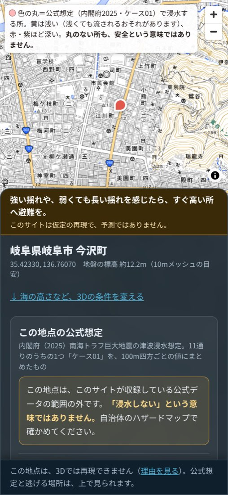
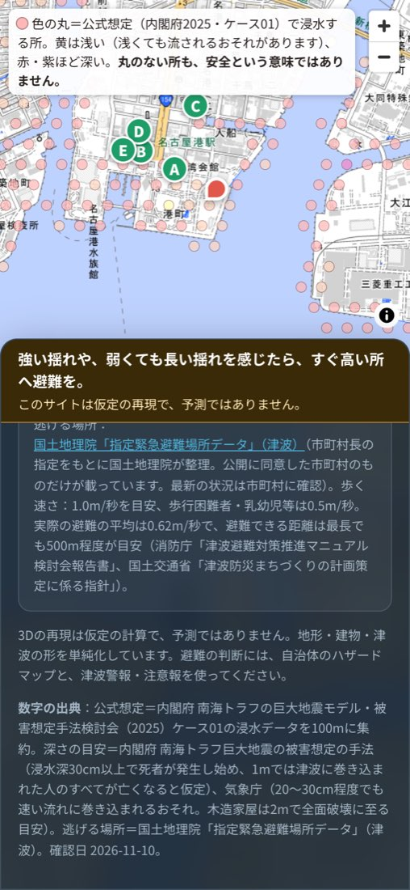

# 「この地点で、3Dで再現する」ボタンを、いつも見える場所に　2026-11-10

本人の指示（マネージャAI経由）：「この地点で 3D 再現するっていうのが、ボタンがね、常に画面上で、見える場所に置いたらいいんじゃないですかね。修正して」

## 置いた位置

地点選択のカードを「スクロールする中身」と「いつも見える下の段」に分け、ボタンを **カードの下の段** に置いた。

- 中身（公式想定・逃げる場所・3Dの条件・出典）をどこまでスクロールしても、ボタンはカードの下端に出たまま。
- ボタンは中身の外にあるので、「揺れたら逃げる」の帯（カードの上端）にも、逃げる場所の項目にも重ならない。中身はボタンの手前で切れる。
- `position: sticky` や `scroll-padding` は使っていない（スクロールが引き戻される動きを作らないため）。
- スマホ幅（カードが下から出る形）でも、PC・タブレット幅（カードが左にある形）でも同じ作り。

## ボタンの状態

| 状態 | 下の段の表示 |
|---|---|
| 地点を選ぶ前 | 下の段を出さない |
| 地点を調べている間 | 「地点を調べています…」（押せない・数秒） |
| 再現できる | **「この地点で、3Dで再現する」**（押せる） |
| その地点は3Dで再現できない（海から遠い など） | ボタンは出さず、「この地点は、3Dでは再現できません（理由を見る）。公式想定と逃げる場所は、上で見られます。」 |
| WebGPU が使えない端末 | 下の段を出さない（押せないボタンを出しっぱなしにしない）。説明は題名の下に出る |

あわせて、PC・タブレット幅で地図の出典表示がカード（ボタン）の裏へ回り込んでいたのを、カードの右側の幅の中で折り返すようにした。

## 確かめた結果（ヘッドレス Chrome・実測）

スクリプト：[scripts/fable52/gobtn.mjs](../../scripts/fable52/gobtn.mjs)。生データは `gobtn/before_report.json`・`gobtn/after_report.json`。
地点（ガーデンふ頭）を選んだあと、カードのスクロールを 最上部・途中・最下部 にして、ボタンの位置を測った。

| 画面 | 変更前（最上部／途中／最下部） | 変更後（最上部／途中／最下部） | 引き戻し | エラー |
|---|---|---|---|---|
| PC 1440×900 | 見えない／見えない／見える | **見える／見える／見える**（y=825 で動かない） | なし | 0 |
| スマホ幅 390×844 | 見えない／見えない／見える | **見える／見える／見える**（y=787） | なし | 0 |
| タブレット 768×1024 | 見えない／見えない／見える | **見える／見える／見える**（y=949） | なし | 0 |
| 横長 1024×768 | 見えない／見えない／見える | **見える／見える／見える**（y=693） | なし | 0 |
| WebGPUなし（スマホ幅・PC幅） | ボタンなし | **ボタンなし**（3か所とも出ない） | なし | 0 |

「見える」の判定：ボタンが画面内にあり、その位置でいちばん手前にあること（ほかの要素に隠れていない）。あわせて、「揺れたら逃げる」の帯・逃げる場所の項目・公式想定の数字・地図の注記・地図の出典と重なっていないことを測った（重なり0件）。

「引き戻し」の判定：スクロール位置を置いたあと0.9秒待っても、その位置のまま。さらに実際のホイール操作で6回下げ（220pxずつ）、位置が 220→440→…→1320 と増えるだけで、止めたあと1.2秒たっても 1320 のまま。

途中までスクロールした位置からボタンを押して、読み込み画面へ進むことも確かめた（4つの幅すべて）。

回帰：前回と同じ11通り（PC・スマホ幅・タブレット・横長・届かない条件×2・内陸・高知・WebGPUなし×2・WebGL2なし）を通し、コンソールエラー0件・画面の重なり0件・60fps。

## 変更前と変更後の画面

### スマホ幅 390×844（カードを途中までスクロールした位置）

| 変更前 | 変更後 |
|---|---|
|  |  |

### PC 1440×900（カードの最上部）

| 変更前 | 変更後 |
|---|---|
|  |  |

### タブレット 768×1024・横長 1024×768（変更後・途中）

| 768×1024 | 1024×768 |
|---|---|
|  |  |

### 3Dで再現できない地点（変更後・スマホ幅）と、WebGPUなし（変更後・最下部）

| 再現できない地点（岐阜市内） | WebGPUなし |
|---|---|
|  |  |

ほかの位置（最上部・最下部）の画面は `gobtn/` にある。

## 確かめていないこと

- 実機のスマートフォン・Safari（アドレスバーの出入りでカードの高さが変わる場面を含む）。ヘッドレス Mac の Chrome で、スマホの画面の大きさとタッチをまねた確認だけ。
